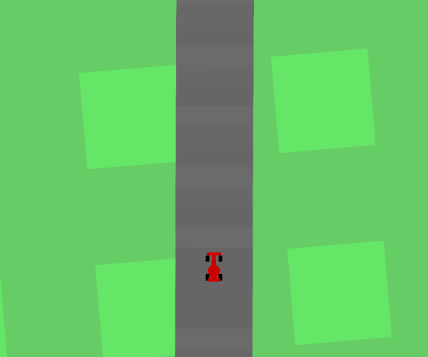
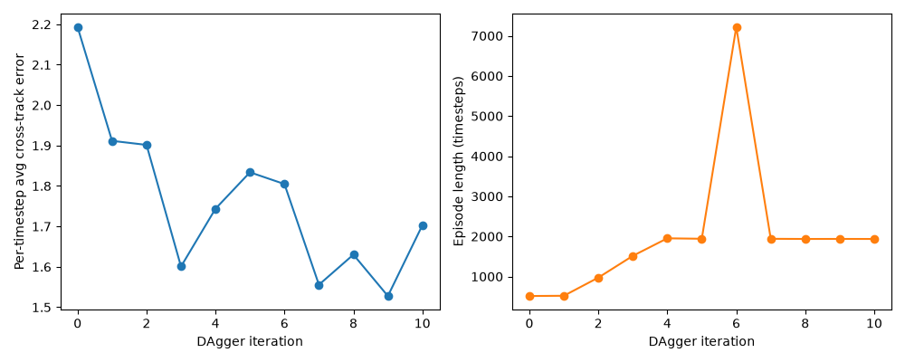

# Learning to Steer: Imitation Learning & DAgger



**Learning visual steering from a PID expert, then improving the policy with on-policy data collection.**

This project modifies and extends materials provided in the **Imitation Learning for Robotics (CSC2626H)** course. Built with Python, PyTorch, and a Gym/Box2D racing simulator, it uses a convolutional network to predict steering from a 128 × 128 RGB observation. DAgger collects expert labels on states visited by the learner and retrains on the aggregated dataset.

The GIF is an actual rollout of the included iteration-10 checkpoint on track seed 0, recorded at the simulator's playback speed. **The CNN controls steering; the PID expert supplies throttle and braking.** This is a steering-learning demonstration in simulation.

The recorded clip contains 1,500 simulation steps (30 seconds), with a mean absolute cross-track error of 1.6198 in simulator units. This measurement covers this clip only.

## Implementation highlights

- **Visual policy:** four convolutional layers and a fully connected classifier map RGB observations to 20 discrete steering commands.
- **Supervised training:** Adam optimization, cross-entropy loss, validation accuracy tracking, and checkpoint selection.
- **Class imbalance experiments:** inverse-frequency loss weighting and mini-batches with 50% straight-driving and 50% turning samples.
- **DAgger:** roll out the learned policy, label its observations with expert steering, aggregate the examples, and retrain over successive iterations.
- **Evaluation:** measure mean absolute cross-track error and episode length during driving, alongside classification accuracy during training.
- **Device support:** automatic selection of Apple Silicon MPS, NVIDIA CUDA, or CPU for the training pipeline.

## Recorded experiment



The saved experiment plot shows lower cross-track error at several later iterations than at iteration 0, with variation between iterations. The longest episode occurs at a different iteration from the lowest error, so these metrics should be considered together. This is a saved training-run plot, not an average over multiple seeds; longer episodes alone do not establish a completed lap. The included iteration-10 model is the final checkpoint, rather than a claim that it is the best on every metric.

## Run the project

Run commands from the repository root. The existing local environment uses Python 3.12. Box2D may require SWIG and a C/C++ compiler on your system.

```bash
python3 -m venv .venv
source .venv/bin/activate
python -m pip install -r requirements.txt
```

`requirements.txt` preserves the original environment's pinned packages. A clean installation on other platforms has not been verified. The simulator uses the project's custom Gym environment and step interface.

### Watch the included steering policy

```bash
python racer.py --learner_weights final_weights/learner_10.weights --timesteps 1500
```

A local graphical desktop is required for the interactive simulator. For the PID expert baseline:

```bash
python racer.py --expert_drives true --timesteps 1500
```

### Re-record the GIF

```bash
python scripts/record_demo.py
```

The recorder runs without a visible window, uses CPU inference, and saves `images/driving-demo.gif`. Defaults: seed 0, up to 1,500 simulation steps, and one frame per four steps at 12.5 FPS. Playback retains simulation timing. Change the checkpoint or seed with `--weights` or `--seed`.

### Train a policy

Training images are not bundled. Place expert-labeled images in `dataset/train/` and a separate held-out set in `dataset/val/`. The loader expects filenames in the form `expert_<run_id>_<timestep>_<steering>.jpg`; steering values range from −1 to 1.

To collect expert demonstrations, use distinct run IDs for separate runs:

```bash
mkdir -p dataset/train dataset/val weights
python racer.py --expert_drives true --save_expert_actions true --out_dir dataset/train --run_id 0
```

Provide a separate validation set before training. The collection command above only populates the training directory; the default simulator track seed is fixed at 0, so separate run IDs alone do not establish generalization to unseen tracks.

```bash
python train_policy.py --weights_out_file weights/learner_0.weights --n_epochs 50

# Optional imbalance treatments (can also be enabled separately)
python train_policy.py --weights_out_file weights/learner_balanced.weights --balanced_batches true --weighted_loss true

# Initial supervised training followed by ten aggregation/retraining rounds
python dagger.py --dagger_iterations 10 --n_epochs 50
```

DAgger adds images to `dataset/train/` and writes checkpoints to `weights/`. Start with a fresh copy of your initial training data when comparing experiments; repeated runs otherwise reuse aggregated data. Balanced sampling requires both straight and turning examples.

## Code guide

| File | Purpose |
| --- | --- |
| `driving_policy.py` | CNN and steering inference |
| `dataset_loader.py` | Filename-based steering labels and balanced sampling |
| `train_policy.py` | Supervised optimization, validation, and checkpointing |
| `dagger.py` | Data aggregation and iterative retraining |
| `racer.py` | Interactive rollouts and expert data collection |
| `full_state_car_racing_env.py`, `pid.py` | Simulation wrapper and PID expert |
| `car_racing.py` | Adapted Gym racing environment |
| `scripts/record_demo.py` | Reproducible GIF recording |
| `images/` | Demo and saved experiment figures |
| `final_weights/learner_10.weights` | Included final model for the demo |

## Project scope and attribution

This project is modified and extended from materials provided in the **Imitation Learning for Robotics (CSC2626H)** course. The learning-related implementations include the CNN, training loop, imbalance handling, DAgger loop, device selection, and rollout metrics. The racing simulator and PID expert are based on the supplied course framework; `car_racing.py` retains its original credit to Andrea PIERRÉ. The environment is adapted from Gym's CarRacing implementation.

The repository keeps source code, curated figures, the demo GIF, and one small final checkpoint. Local virtual environments, datasets, intermediate models, editor settings, the assignment handout, and submission archives are excluded through `.gitignore`.
